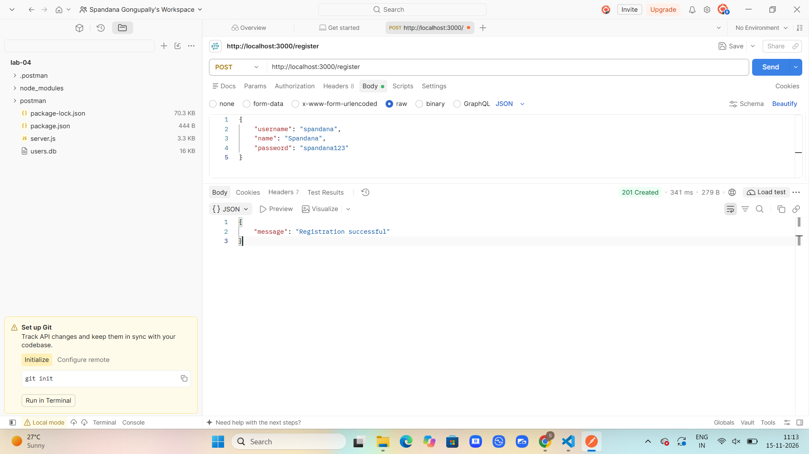
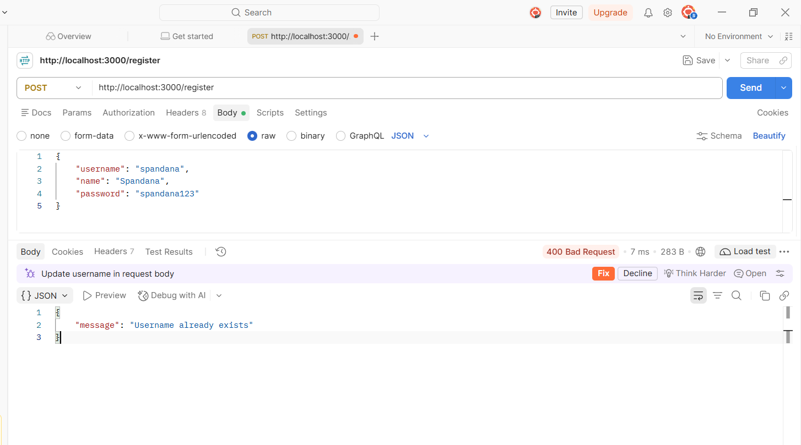
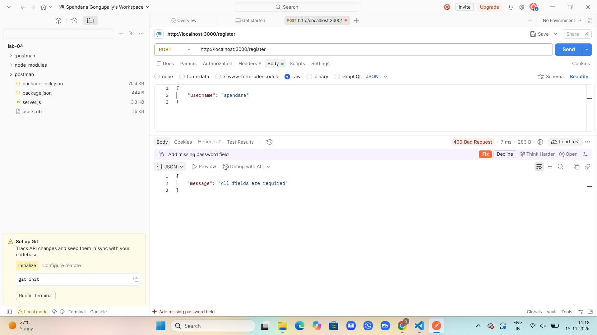
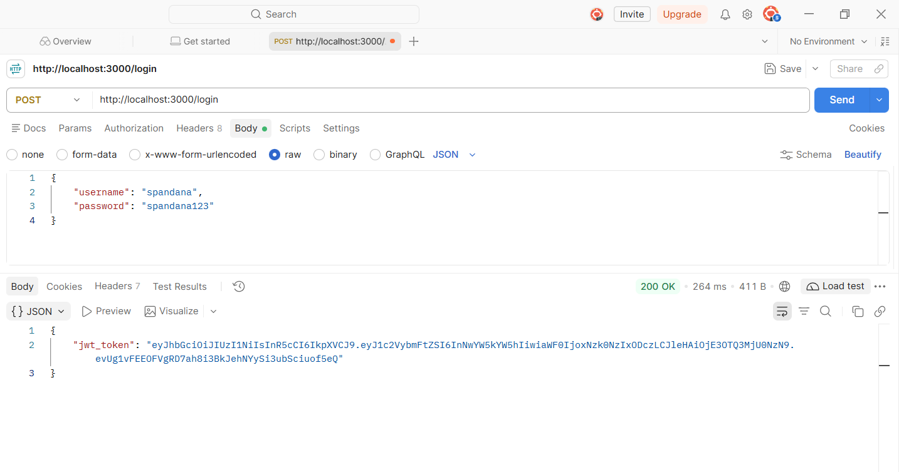
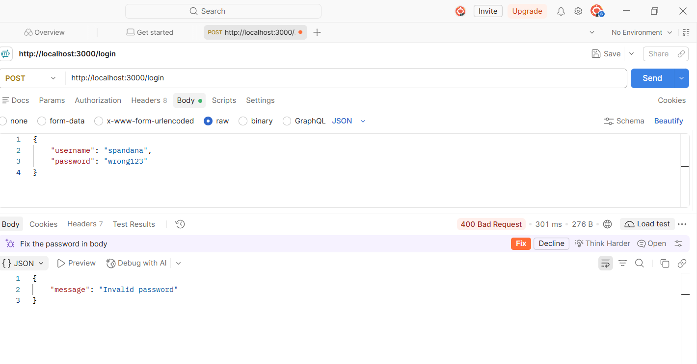
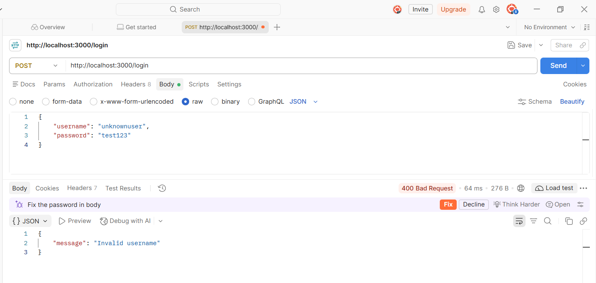
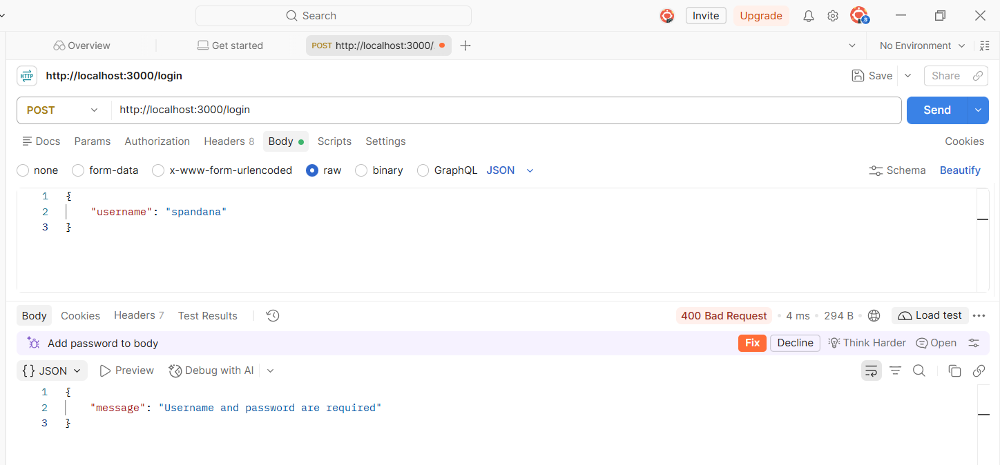
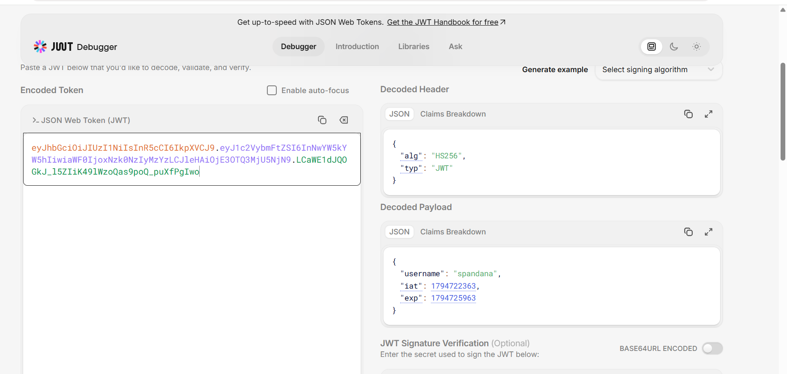
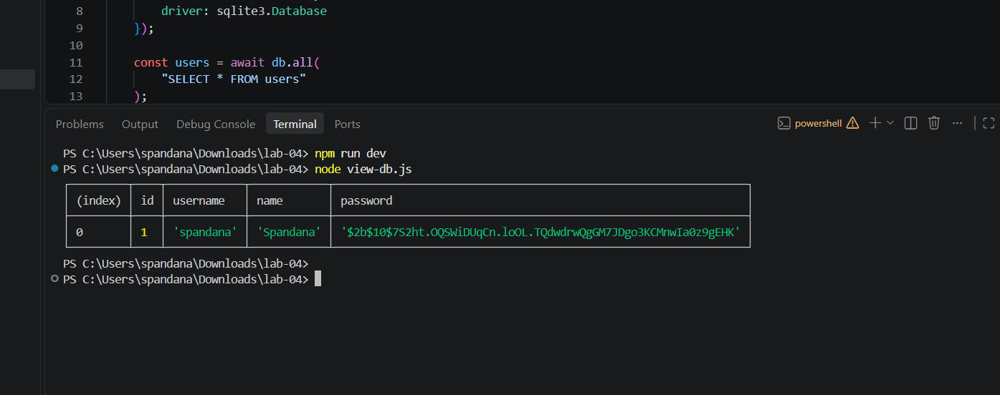

# Lab 4: Registration, Login and JWT

## Student Details

- Name: GONGUPALLY SPANDANA
- Registration Number: 252U1R6082
- Section: CSE(AIML)

## Objective

To implement user registration and login using bcrypt password hashing and JWT authentication.

## Technologies Used

- Node.js
- Express.js
- SQLite
- bcrypt
- jsonwebtoken
- Postman

## Installation

1. Clone the repository.
2. Open the lab-04 folder.
3. Install the dependencies.

```bash
npm install
```

4. Start the server.

```bash
npm run dev
```

Server URL:

http://localhost:3000

## Database

The users table contains:

- id
- username
- name
- password

Passwords are stored as bcrypt hashes.

## API Endpoints

| Method | Endpoint | Description |
| POST | /register | Register a new user |
| POST | /login | Login and generate JWT token |

## Screenshots

### 1. Successful Registration



### 2. Duplicate Username



### 3. Invalid Registration



### 4. Successful Login



### 5. Wrong Password



### 6. Unknown Username



### 7. Invalid Login



### 8. JWT Token Decoding



### 9. Database Password Hash



## Viva Questions

1. Why POST for login?
POST is used because login sends sensitive information in the request body.

2. What is the difference between hashing and encryption?
Hashing is a one-way process, whereas encryption can be reversed using a key.

3. What does jwt.sign need?
It needs a payload, a secret key and optional signing options.

4. What should never go into the JWT payload?
Passwords and other sensitive information should never be included.

## Problems Faced and Solutions

- Installed the required npm packages.
- Created the SQLite users table.
- Used bcrypt to hash passwords.
- Used JWT to generate login tokens.
- Tested valid and invalid inputs using Postman.

## Live Link

Not deployed yet. Local testing completed using Postman.
